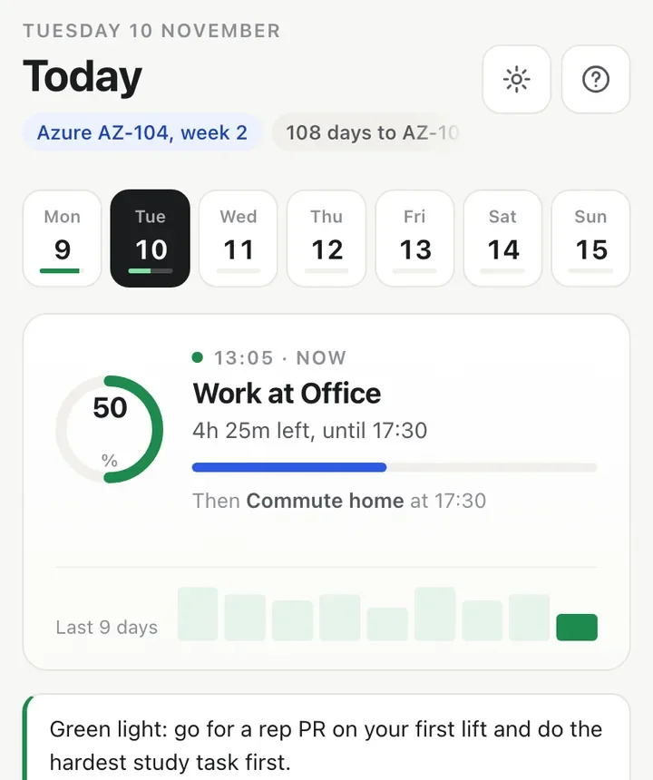
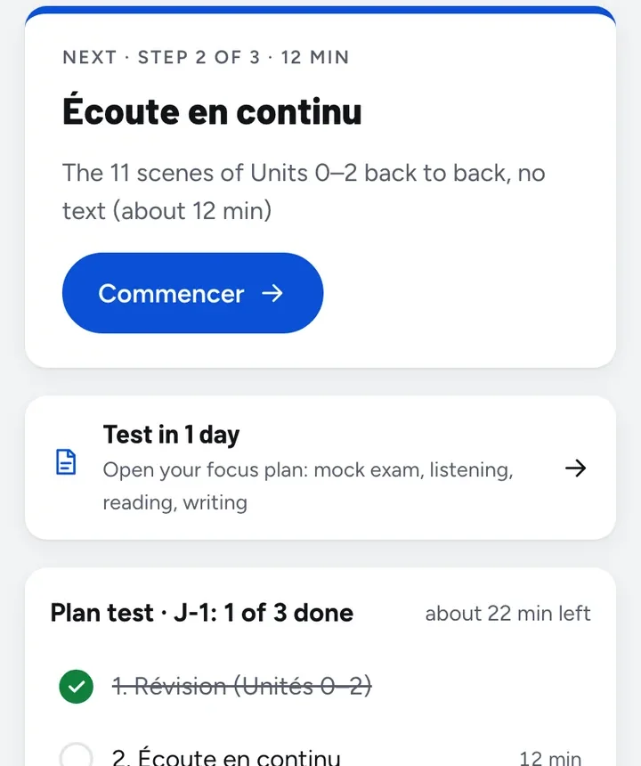
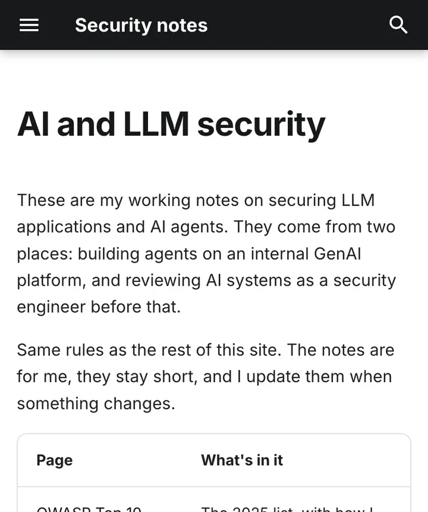

<picture>
  <source media="(prefers-color-scheme: dark)" srcset="assets/banner-dark.svg">
  
</picture>

  
  
  
  

## Hi, I'm Taha

I work on AI enablement and security in Luxembourg. Most days that means sitting with teams to find the AI use cases worth building, turning the best ones into agents that run in production, and keeping model traffic behind proper guardrails. I came up through security engineering, and I'm finishing an M.Sc. in Data Science (NLP) at Universität Trier.

- **Now:** AI discovery workshops, a scored use-case portfolio, and the design of a voice AI agent (intents, telephony, knowledge base)
- **Before:** agents and agentic RAG in production, FastAPI agent endpoints on Kubernetes, LLM APIs behind a gateway, threat modelling for ML systems
- **Studying:** IAPP AIGP and Azure Solutions Architect Expert, plus a thesis on fine-tuning language models to find bugs in code
- **Away from the keyboard:** swimming, football and French lessons

The full résumé lives on [my website](https://gandhi-taha.github.io).

## Things I built

<table>
  <tr>
    <td width="33%" valign="top">
      
       <b><a href="https://github.com/gandhi-taha/plan">Improvement Plan</a></b>
       Study, gym and French fitted around office hours, with a day outlook. Offline PWA; data stays in a private repo.
    </td>
    <td width="33%" valign="top">
      
       <b><a href="https://github.com/gandhi-taha/french">Manuel de français</a></b>
       My A1 to A2 French course: lessons, listening, vocabulary and a test plan. Installs on Android, works without signal.
    </td>
    <td width="33%" valign="top">
      
       <b><a href="https://github.com/gandhi-taha/security">Security notes</a></b>
       150+ pages of pentest notes, from web apps and Active Directory to cloud and Kubernetes, plus AI and LLM security.
    </td>
  </tr>
</table>

Also worth a look: [Thesis_NLP](https://github.com/gandhi-taha/Thesis_NLP) (SFT and DPO fine-tuning for bug detection), [awesome-ai-security](https://github.com/gandhi-taha/awesome-ai-security) (frameworks, standards, red teaming) and [doc-agent](https://github.com/gandhi-taha/doc-agent) (question answering over PDFs).

## Notes on AI security

| | Note | What's inside |
|---|---|---|
| 01 | [OWASP Top 10 for LLM applications](https://gandhi-taha.github.io/security/ai_security/owasp_llm_top_10/) | The 2025 list, how I test each item, and what actually fixes it |
| 02 | [Prompt injection](https://gandhi-taha.github.io/security/ai_security/prompt_injection/) | Where untrusted text gets in, first test cases, defences that hold up |
| 03 | [Agents and MCP](https://gandhi-taha.github.io/security/ai_security/agents_and_mcp/) | A threat model for tool-using agents, MCP and A2A, and a review checklist |
| 04 | [The LLM gateway pattern](https://gandhi-taha.github.io/security/ai_security/llm_gateway/) | Routing all model traffic through one controlled path |
| 05 | [AI governance for security people](https://gandhi-taha.github.io/security/ai_security/ai_governance/) | EU AI Act, NIST AI RMF and ISO/IEC 42001, mapped to security work |

## Toolbox

<picture>
  <source media="(prefers-color-scheme: dark)" srcset="assets/toolbox-dark.svg">
  
</picture>

## Contributions

<picture>
  <source media="(prefers-color-scheme: dark)" srcset="https://raw.githubusercontent.com/gandhi-taha/gandhi-taha/output/github-contribution-grid-snake-dark.svg">
  
</picture>
